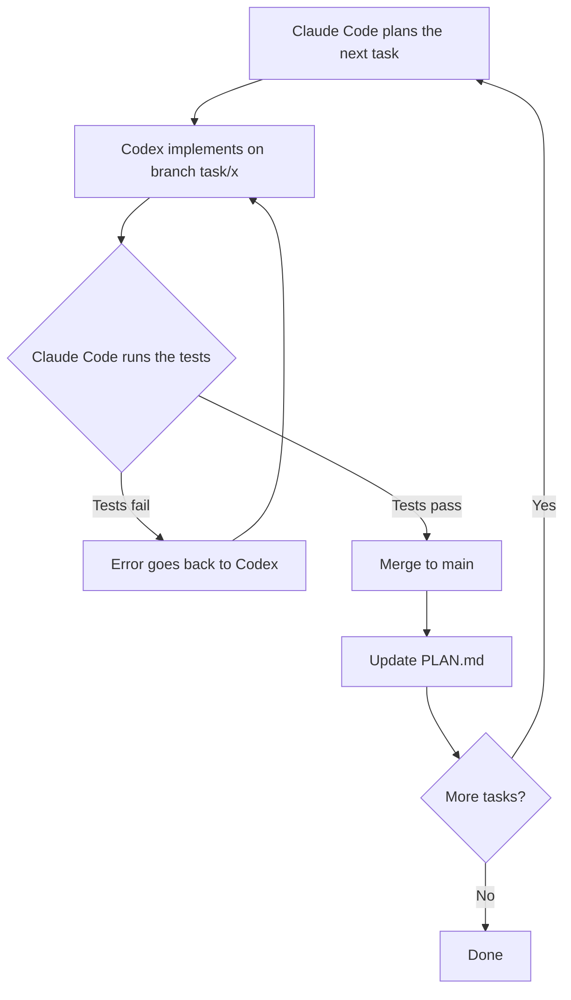

# Harness

**A Claude Code + Codex agent harness**

[](https://github.com/andresListorti/harness/actions/workflows/ci.yml)

## What it is

Harness is a two-agent development loop: Claude Code plans and orchestrates, and Codex implements through the official `codex-plugin-cc` plugin.
Tests, not the agents, decide when each task is finished.

## Why

A single agent does not reliably catch its own mistakes. In Harness, one model family implements and a different one verifies: the orchestrator runs the tests itself instead of trusting the worker's report. Splitting the work across two fixed-price plans also keeps costs predictable, with no per-token billing.

## The loop



## How it works

**Roles**

- **Claude Code is the orchestrator.** It splits the work into small tasks, briefs Codex, runs the tests, and owns branches, commits, merges, and `PLAN.md`.
- **Codex is the worker.** For each task it receives a goal, the files involved, and a definition of done.

**One branch per task.** Each task runs on its own `task/<short-name>` branch and merges to `main` only after it passes.

**Tests are the referee.** The orchestrator runs the tests itself rather than trusting the worker's report. If they fail, the error goes back to Codex. If Codex fails twice on the same task, the loop stops and asks a human.

The full rules are in [CLAUDE.md](CLAUDE.md). The design reasoning is in [docs/architecture.md](docs/architecture.md).

## Results from the example app

[`example-app/`](example-app/) is a to-do REST API built entirely through this loop.

| Metric | Result |
|---|---|
| Tasks completed | 10 of 10 |
| Total Codex attempts | 11 |
| Retries | 1 |
| Tasks escalated to a human | 0 |
| Tests | 109 passing, in 9 files |
| Commits on `main` to build it | 22 (12 regular, 10 merges) |

The single retry was a review fix on the first task (replacing `latest` dependency tags with pinned versions), not a test failure. One earlier run was blocked by the sandbox before it attempted the task, and it is not counted as an attempt. Task-by-task details are in [docs/run-log.md](docs/run-log.md) and [example-app/PLAN.md](example-app/PLAN.md).

## Dashboard

The local Harness dashboard shows repo questions, historical agent cards, a galaxy of repo data, and the plan board. Milestone 1 is read-only and local; see [dashboard/README.md](dashboard/README.md) for requirements, development commands, security, and limits.

With Node 24 and npm, start from the repo root:

```sh
cd dashboard
npm ci
npm run build && npm start
```

Open `http://127.0.0.1:3001`.

## Design notes

- **The Codex sandbox has no network**, so the orchestrator installs dependencies as an environment step.
- **Codex cannot write to `.git`**, so the orchestrator creates all branches and commits.

## Setup and stack

See [docs/setup.md](docs/setup.md) for installation, login, the plugin, and Windows notes.

- **Harness:** Claude Code, Codex CLI, `codex-plugin-cc`
- **Example app:** TypeScript, Node.js, Express, Zod, Vitest, Supertest
- **CI:** GitHub Actions

## License

[MIT](LICENSE)
